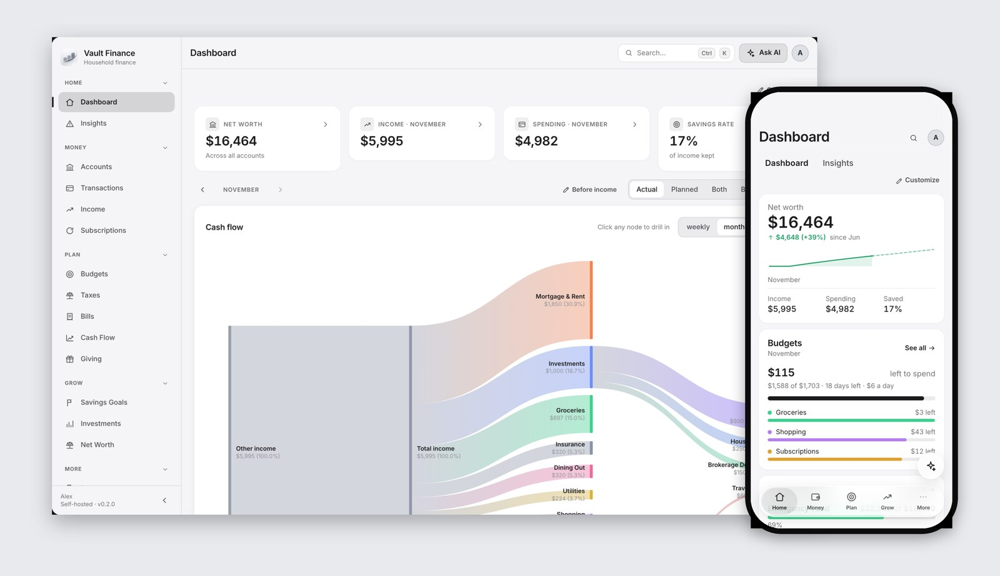
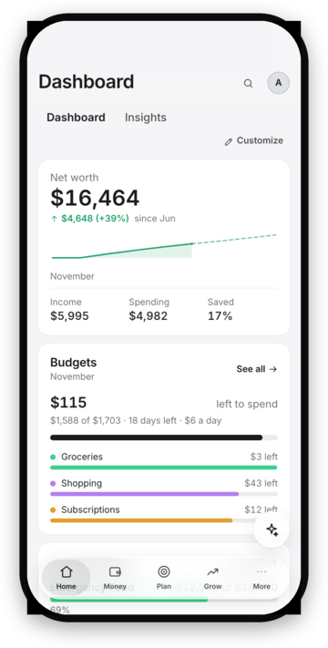
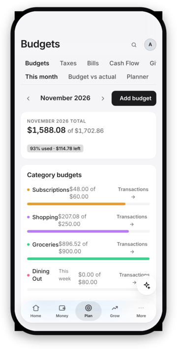
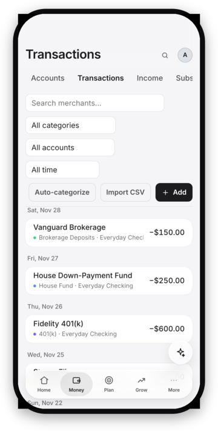
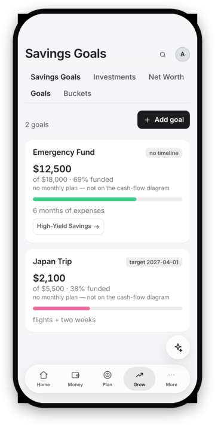
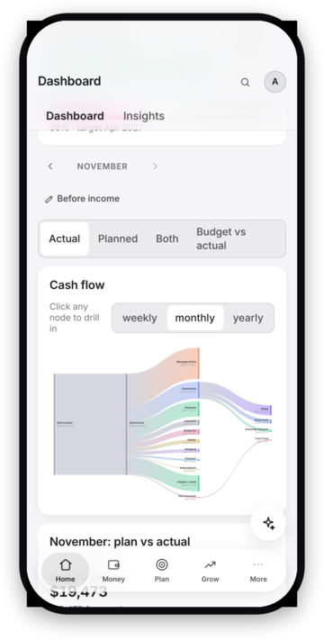
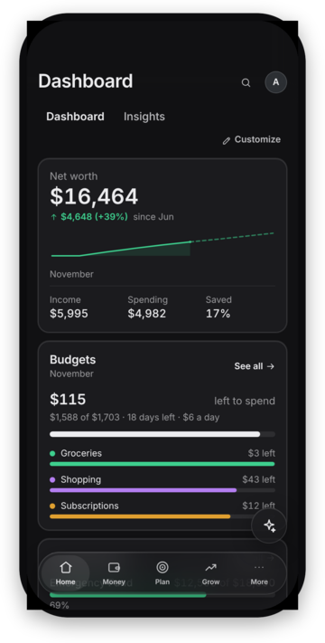
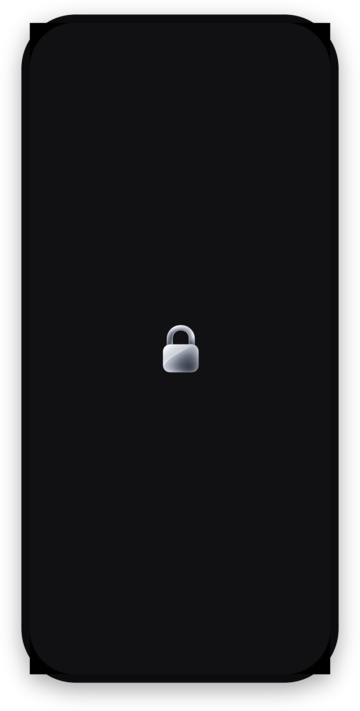
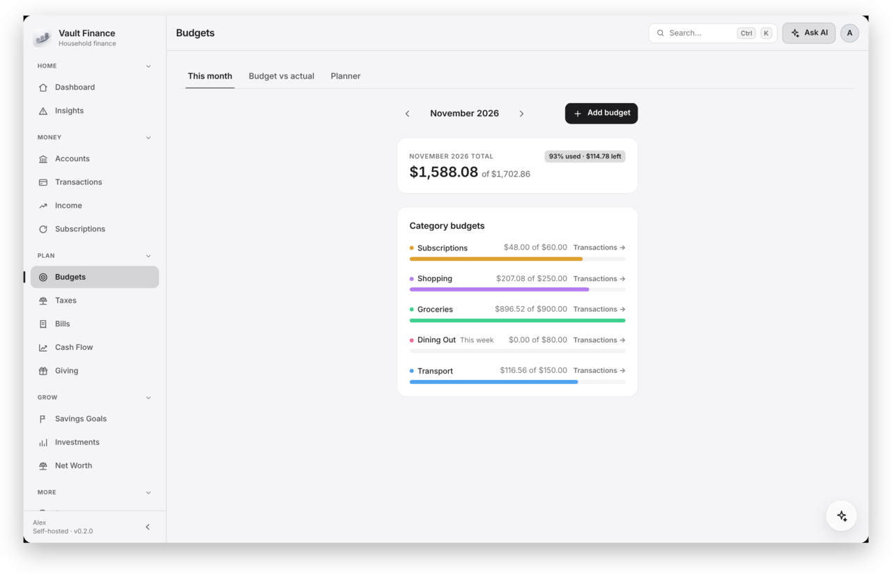
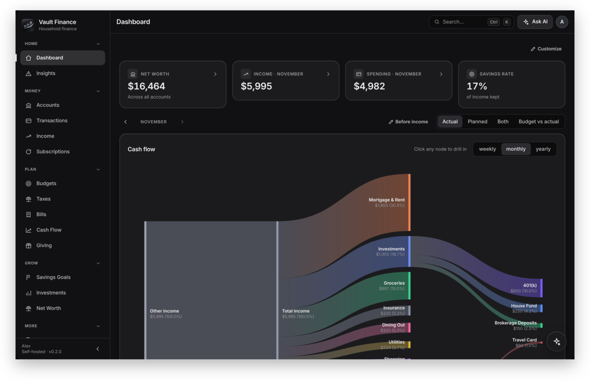

<p align="center">
  <picture>
    <source media="(prefers-color-scheme: dark)" srcset="docs/images/app-icon-dark.png">
    
  </picture>
</p>

<h1 align="center">Vault Finance</h1>

<p align="center">
  <strong>Private, self-hosted household finance.</strong><br>
  Budgets, cash flow, goals and investments on your computer and your iPhone,<br>
  served from a machine you own. Nothing leaves your hardware.
</p>

<p align="center">
  <a href="https://github.com/nomad9021/vault-finance/releases/latest"></a>
  <a href="https://github.com/nomad9021/vault-finance/actions/workflows/ci.yml"></a>
  <a href="LICENSE"></a>
  
</p>

<p align="center">
  <picture>
    <source media="(prefers-color-scheme: dark)" srcset="docs/images/hero-dark.jpg">
    
  </picture>
</p>

## Why Vault Finance

- **Yours, end to end.** A Fastify + PostgreSQL server runs on your own machine (Docker Compose), with its data in an encrypted volume (offered by the installer, on by default on Linux). The apps talk to it over your LAN or Tailscale with a pinned certificate. No accounts with us, no telemetry, ever.
- **The whole household.** One server, everyone's accounts. Each new device has to be approved, sign-in can use Face ID, Touch ID or Windows Hello, and the app locks itself the moment you look away.
- **See where it goes.** A cash-flow diagram from income to every category, weekly or monthly budgets that reset on their own, savings goals, net worth over time, bills, subscriptions, taxes and investments.
- **Desktop and iPhone.** Native apps for Windows, macOS and Linux with signed auto-updates, and an iPhone app with Face ID, a frosted Liquid Glass tab bar and a lock screen that shows nothing but a padlock.
- **AI if you want it.** Off by default. Bring your own: Ollama or any OpenAI-compatible server on your own GPU, or your own OpenAI / Anthropic key ([ADR-0006](docs/adr/0006-optional-multi-provider-ai.md)).

## Screenshots

<table>
  <tr>
    <td align="center"><br><sub>Home</sub></td>
    <td align="center"><br><sub>Budgets</sub></td>
    <td align="center"><br><sub>Transactions</sub></td>
    <td align="center"><br><sub>Savings goals</sub></td>
  </tr>
  <tr>
    <td align="center"><br><sub>Cash flow</sub></td>
    <td align="center"><br><sub>Dark mode</sub></td>
    <td align="center"><br><sub>Locked (Face ID)</sub></td>
    <td></td>
  </tr>
</table>

<p align="center">
  
  
</p>

<sub>Screenshots use made-up demo data.</sub>

## Quick start

1. **Server:** on an always-on Linux machine, run
   `curl -fsSL https://raw.githubusercontent.com/nomad9021/vault-finance/main/installers/server/bootstrap.sh | bash`
   and answer a few questions ([details below](#1-install-the-server)).
2. **Desktop app:** download it for Windows, macOS or Linux from the [latest release](https://github.com/nomad9021/vault-finance/releases/latest).
3. **Connect:** enter your server's address, confirm its fingerprint once, and create the owner account.
4. **iPhone (optional):** build it on a Mac with your Apple ID; see [docs/ios.md](docs/ios.md).

---

## Installation

You install the **server once** on an always-on machine, then install the
**desktop app** on each device you use. All the install tooling lives in
[`installers/`](installers/).

### 1. Install the server

#### One-line install (Linux)

On a fresh Linux server (Ubuntu/Debian, Fedora, or Arch), as root or a user
with sudo:

```bash
curl -fsSL https://raw.githubusercontent.com/nomad9021/vault-finance/main/installers/server/bootstrap.sh | bash
```

It installs git and Docker if they're missing, clones the repo to
`~/vault-finance`, and starts the guided installer below. Re-running it
updates the checkout and re-runs the installer with your saved answers. Set
`VF_DIR` to clone somewhere else, or pass installer flags with
`| bash -s -- --yes`. Prefer to read it first? It's
[`installers/server/bootstrap.sh`](installers/server/bootstrap.sh).

The rest of this section is the same thing, step by step.

#### Prerequisites

- A **64-bit machine that stays on** — a home server, NAS, mini-PC, or spare
  desktop. Ubuntu LTS (20.04/22.04/24.04), other Linux, or macOS all work.
- **Docker Engine + the Compose plugin.** The installer checks for these and
  stops with a clear message if they're missing.
- **git** — the server image is built from source during install.
- **Disk:** ~1 GB for app + database to start (grows with your data), plus
  **4–20 GB per AI model** if you enable local AI.
- **RAM:** 2 GB is plenty for the finance stack; add more only for a local AI
  model.

#### Ubuntu / Linux — step by step

Install Docker (official script — installs Engine, Compose, and buildx):

```bash
curl -fsSL https://get.docker.com | sudo sh
```

Make sure the Docker daemon is running now and starts on every boot:

```bash
sudo systemctl enable --now docker
```

Let your user run Docker without sudo, then **log out and back in** (or run
`newgrp docker` in the current terminal) — the new group doesn't apply to
shells that were already open:

```bash
sudo usermod -aG docker $USER
newgrp docker
```

Check it works without sudo — this should print a table, not an error:

```bash
docker ps
```

Install git if needed:

```bash
sudo apt-get update && sudo apt-get install -y git
```

Clone the repo:

```bash
git clone https://github.com/nomad9021/vault-finance.git
```

Run the guided installer and answer its questions:

```bash
cd ~/vault-finance
bash installers/server/install-server.sh
```

(If you're already inside the `vault-finance` folder, skip the `cd` — just run
the `bash …` line. `cd vault-finance` from inside it fails with
"No such file or directory".)

It asks:

- **Where to store your files** (`VAULT_DISK`) — put this on your big or
  dedicated drive if you have one (e.g. `/mnt/data/vault`). Holds the database,
  uploaded receipts, the TLS certificate, and any AI models.
- **Lock it with a passphrase?** — default yes (Linux). Everything in that
  folder goes into an encrypted volume nobody can read without your
  passphrase; after a restart, run `bash installers/server/vault-storage.sh
  unlock` to start the server again.
- **HTTPS port** (default `8443`).
- **Database password** — press Enter for a strong random one.
- **Local AI?** — default no; you can turn it on later in the app.
- **Owner account?** — create your login now, or later from the desktop app's
  setup wizard.

Then it writes `docker/.env`, creates the data directories, runs
`docker compose up -d --build` (first build takes a few minutes), waits for the
API, and prints the address to connect to. Run with `--dry-run` first if you
want to preview everything without touching Docker.

If the installer stops at the Docker check, it tells you which problem it hit:

| Message | Fix |
|---|---|
| *The Docker daemon isn't running* | `sudo systemctl enable --now docker` (the installer offers to run this for you) |
| *User '…' can't talk to Docker* | `sudo usermod -aG docker $USER`, then `newgrp docker` or log out and back in |
| *You're in the 'docker' group, but this shell doesn't know yet* | Log out and back in, or run `newgrp docker` |

Then re-run the installer.

#### Windows server (Docker Desktop)

```powershell
git clone https://github.com/nomad9021/vault-finance.git
cd vault-finance
pwsh -File installers\server\install-server.ps1
```

More detail — remote access, custom TLS, backups, updating, troubleshooting:
[docs/self-hosting.md](docs/self-hosting.md) and
[installers/server/](installers/server/).

### 2. Install the desktop app

Download the installer for your OS from the
[Releases page](https://github.com/nomad9021/vault-finance/releases/latest)
(`.exe`/`.msi` for Windows, `.dmg` for macOS, `.AppImage`/`.deb` for Linux),
or build it yourself — see [installers/desktop/](installers/desktop/).

### 3. Connect the desktop app

Open the app and enter your server address:

| How you reach the server | Address to enter |
|---|---|
| Same LAN | `https://192.168.x.x:8443` or `https://hostname.local:8443` |
| Tailscale / VPN | `https://<tailscale-ip-or-name>:8443` |
| Reverse proxy with real TLS | whatever hostname the proxy serves |

The server uses a self-signed certificate by default; the first connection
shows its fingerprint, you confirm once, and the app pins it. **Don't
port-forward 8443 to the open internet** — use Tailscale or a hardened reverse
proxy for remote access.

Every time it opens, the app runs a quick **system check** (network,
Tailscale, server, versions, database, disk, AI, bank sync). The household
owner sees it and gets a plain-language fix if anything is wrong; other
members just see the app icon while it starts, and a one-line explanation if
something stops it opening. Opening the app also syncs your bank data. If your server is on Tailscale and
Tailscale is off, the app can **turn it on for you** — from the connect
screen, the system check, or **Settings → Tailscale**.

### 4. Name your household and add family members

The setup wizard asks for a **household name** (e.g. "The Carters") — it's
optional and the owner can change it any time in **Settings → Household**.
Everyone who signs in to your server is in that one household and shares its
accounts; add the other adults from **Settings → Family members** (connect your
email once and invite them by address, or create them a login with a temporary
password). The household name
shows on the sign-in screen and in the sidebar for all of you.

### 5. Approving new devices

The server has to **let each new device in** — a password alone isn't
enough. The first time a computer or phone signs in, it shows a 6-digit code
and waits. Approve it from a device that's already signed in (a prompt
appears — type the code and choose **Allow**), or on the server:

```bash
docker compose exec server vault approve 482913
```

The owner picks which of the two are allowed in **Settings → Approved
devices**, and can remove a lost device there. Devices that were already
signed in when you upgrade stay approved. Details:
[operations.md](docs/operations.md#3a-device-approval--the-server-lets-you-in).

### 6. (Optional) Sign in with Windows Hello, Touch ID, or your fingerprint

After signing in once with your password, open **Settings → Sign in with …**
and choose **Turn on**. From then on the app opens locked and asks for your
face / fingerprint / Windows Hello PIN; your password still works as a
fallback. Each person turns it on for themselves, on each computer.

| OS | What's used | Requirements |
|---|---|---|
| Windows 10/11 | Windows Hello (face, fingerprint, or PIN) | Set up in *Settings → Accounts → Sign-in options* |
| macOS | Touch ID | A Mac or keyboard with Touch ID, with a finger enrolled |
| Linux | Fingerprint reader via `fprintd` | `fprintd` installed, a [libfprint-supported reader](https://fprint.freedesktop.org/supported-devices.html), and a finger enrolled (`fprintd-enroll`) |

Nothing biometric leaves your computer — the server only stores a revocable
per-device key ([ADR-0008](docs/adr/0008-biometric-sign-in.md)). Revoke a lost
device's key from the same Settings card.

### 7. Updating the desktop app

The **download button next to your avatar** (top right) checks for a new
release and shows a dot when one is waiting; click it and choose **Install &
restart**. The same controls are in **Settings → Updates**. Updates are
signature-checked before installing. On Linux this works for the `.AppImage`;
if you installed the `.deb` (or an extracted AppImage), download the new
version from the Releases page instead.

### 8. (Optional) Phone viewer

Open `https://<server-ip>:8443/` in your phone's browser for the read-only
mobile view, and add it to your home screen. It locks the moment you switch
away and signs out after a few minutes idle.

### 9. (Optional) The iPhone app

The full iPhone app is the desktop app built for iOS: the same screens with a
phone layout, Face ID, a Liquid Glass tab bar, swipe actions and pull to
refresh. It locks as soon as you swipe away, and the app switcher only ever
shows a padlock. It's built and signed on a Mac with your Apple ID (a free one
works, with installs that renew every 7 days); see [docs/ios.md](docs/ios.md).

---

## Repository layout

```
apps/
  desktop/        Tauri 2 + React desktop app (source)
  server/         Fastify + PostgreSQL API server
packages/         Shared workspace packages (schemas, API client, UI, tokens)
installers/
  server/         Interactive server installers (Linux/macOS + Windows)
  desktop/        How to get / build the desktop app
docker/           Docker Compose stack + Dockerfile (the server's build context)
design/           Design references
docs/             Guides, architecture, ADRs, self-hosting, releasing
scripts/          Repo tooling (dev stack, demo seed, version bump)
```

## Documentation

| Doc | What it covers |
|---|---|
| [how-it-works.md](docs/how-it-works.md) | Feature tour — what each screen does |
| [architecture.md](docs/architecture.md) | System overview, network diagram |
| [folder-structure.md](docs/folder-structure.md) | Monorepo layout |
| [database-schema.md](docs/database-schema.md) | PostgreSQL schema |
| [api-design.md](docs/api-design.md) | REST API, auth flows, streaming |
| [self-hosting.md](docs/self-hosting.md) | Deploying and operating your server |
| [operations.md](docs/operations.md) | Data location, 2FA, backups, lockout recovery |
| [ios.md](docs/ios.md) | Building and running the iPhone app |
| [releasing.md](docs/releasing.md) | Cutting desktop releases (maintainers) |
| [roadmap.md](docs/roadmap.md) | Milestones M1–M6 |
| [docs/adr/](docs/adr/) | Architecture decision records |

## Development

Requirements: Node 22+, pnpm 9 (via corepack), Docker (for the full stack).

```bash
pnpm install
pnpm build          # build all workspace packages
pnpm test           # server e2e tests run against a real embedded Postgres
pnpm --filter @vault/server dev   # dev server with hot reload
```

The server dev process needs a `DATABASE_URL` pointing at any Postgres 16+;
`docker compose -f docker/docker-compose.yml up -d postgres` gives you one.

## Status

**v0.2.0** adds the iPhone app and a new look on every platform: new icons, a
neutral palette, Liquid Glass on the floating controls, motion that never runs
past 300ms, weekly budgets, bank sync whenever the app opens, and start-up
checks shown only to the household owner. Phase 1 (M1–M6) is complete; see
[roadmap.md](docs/roadmap.md) for what's next.

## Licence

Vault Finance is free software under the [GNU Affero General Public License
v3.0](LICENSE) (AGPL-3.0-only). In short: you may use, study and change it, but
if you distribute it, or run a modified version for other people over a
network, you must make your complete source code available to them under the
same licence.

Copyright © 2026 nomad9021. Versions up to and including v0.2.0 were released
under the MIT licence.
