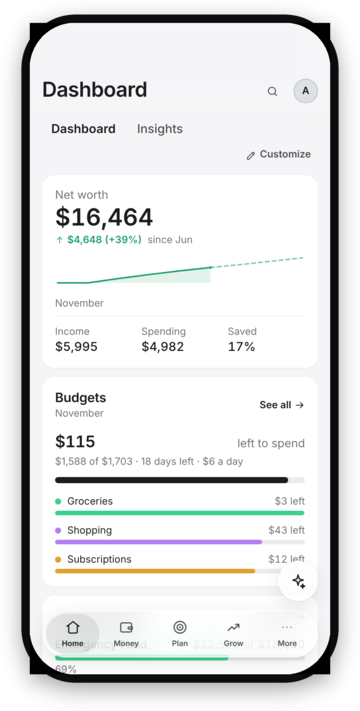
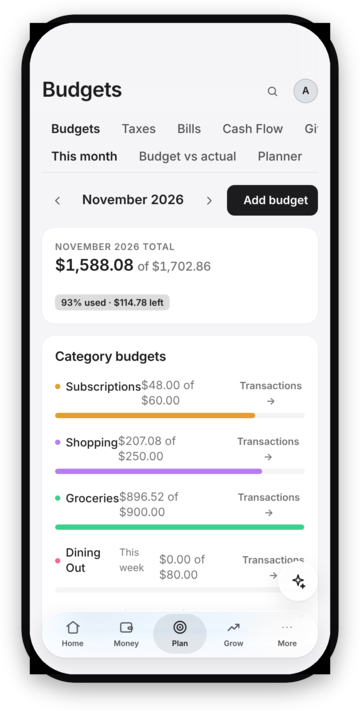
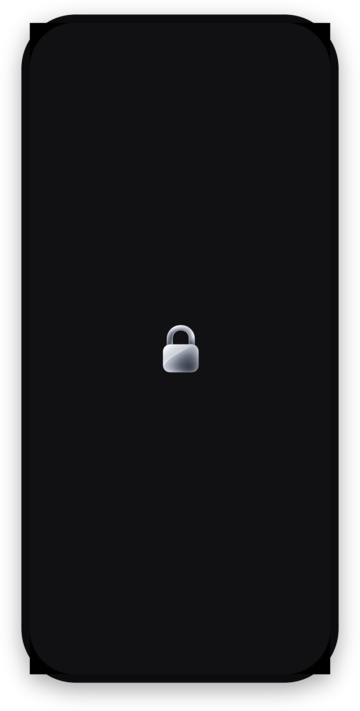

# iOS app

<p align="center">
  
  
  
</p>

The iPhone app is the desktop app's own Tauri shell built for iOS: same React
screens, same Rust transport (pinned TLS, keychain), same server API. There is
no separate codebase. Below 900 px wide the shell already switches to the phone
layout (bottom tab bar), which is what the iPhone gets.

## What differs on iPhone

| | Desktop | iPhone |
|---|---|---|
| Sign-in secrets | OS keychain | iOS Keychain (same `keyring` code) |
| Biometric sign-in | Windows Hello / Touch ID / fprintd | Face ID or Touch ID (`tauri-plugin-biometric`), no passcode fallback |
| Locks when | screen lock, sleep, idle, Ctrl/Cmd+L | all of those, plus the moment the app stops being active (swiping up, Control Centre, a call); the app-switcher snapshot is a native cover showing only a padlock |
| Unlocking | biometrics or password | with Face ID set up, an empty page with a padlock while Face ID runs, then straight in; the sign-in page only if Face ID fails |
| Look | sidebar | floating Liquid Glass tab bar and title bar, bottom sheets, swipe actions, pull to refresh, Dynamic Type |
| App icon | one icon | light icon, plus the dark icon in iOS dark mode |
| Updates | in-app updater | install the new build onto the phone |
| Tailscale | in-app on/off (CLI) | turn on the Tailscale iOS app; the in-app control is hidden |
| Admin console window | yes | no (one window) |
| Outside links | default browser | Safari (`tauri-plugin-opener`) |

iOS-only files: `apps/desktop/src-tauri/tauri.ios.conf.json` (single window,
iOS 16+), `Info.ios.plist` (Face ID and local-network prompts) and
`capabilities/ios.json` (no updater permission). The stylesheet's
`:root[data-platform="ios"]` rules keep the header and tab bar clear of the
notch and home indicator.

## Building (on a Mac)

Needs Xcode, an Apple ID signed into Xcode (a free one works; its installs
expire after 7 days), and the Rust iOS targets:

```sh
rustup target add aarch64-apple-ios aarch64-apple-ios-sim x86_64-apple-ios
pnpm install
cd apps/desktop
pnpm ios:init      # once: generates src-tauri/gen/apple (git-ignored)
pnpm ios:dev       # Simulator, live reload from Vite
pnpm ios:build     # signed .ipa for your own iPhone
```

Before the first device build, set your team in Xcode
(`src-tauri/gen/apple/*.xcodeproj` → Signing & Capabilities) or export
`APPLE_DEVELOPMENT_TEAM`.

## Connecting to the server

The phone connects the same way the desktop does: enter the server address,
check the certificate fingerprint, sign in, approve the device from a trusted
one. At home use the LAN address; away from home, turn on Tailscale and use the
server's Tailscale name. The first connection on the LAN triggers iOS's
"find devices on your local network" prompt, which must be allowed.

## App icons

`src-tauri/icons/ios/` holds the iOS icon set (light artwork) and
`src-tauri/icons/ios-dark/AppIcon-dark-1024.png` the dark-mode icon. Because
`gen/apple` is generated on the Mac and not committed, copy them into
`gen/apple/Assets.xcassets/AppIcon.appiconset` before building, as a
single-size icon with a dark appearance:

```json
{
  "images": [
    { "filename": "AppIcon-light-1024.png", "idiom": "universal", "platform": "ios", "size": "1024x1024" },
    { "appearances": [{ "appearance": "luminosity", "value": "dark" }],
      "filename": "AppIcon-dark-1024.png", "idiom": "universal", "platform": "ios", "size": "1024x1024" }
  ],
  "info": { "author": "xcode", "version": 1 }
}
```

## Keeping it installed

With a free Apple ID, an install stops opening after 7 days. Rebuilding and
reinstalling renews it, and that can run on its own: a `launchd` agent in the
Mac's logged-in session (code signing needs the login keychain, which an SSH
session can't use) that runs hourly, rebuilds when the code changes or the
signature has under two days left, and installs on every paired iPhone it can
reach with `xcrun devicectl device install app`. The phone must be paired with
the Mac once over USB and, for installs over Wi-Fi, have **Connect via
network** ticked in Xcode's Devices window.

